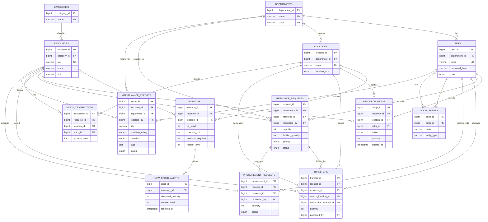

# Project design

## Problem statement

Campus equipment and supplies are held by multiple departments, laboratories, and stores. A new request can trigger unnecessary purchasing when usable surplus already exists elsewhere. CampusFlow records stock and protected local minimums, prioritizes needs, recommends safe transfers first, and reports the remaining procurement gap.

## Objectives and functional requirements

1. Maintain resource, category, department, user, location, and location-level stock records, distinguishing reusable equipment from consumables and tracking equipment checkout/return.
2. Authenticate administrators, staff, and students; let administrators create staff and student accounts within configured departments; scope staff and student requests to their own account and protect transfer/procurement approvals behind the administrator role.
3. Submit prioritized requests with a purpose and optional needed-by date.
4. Search campus inventory and inspect on-hand, checked-out stock, and minimums by location.
5. Recommend transfers from other locations only when stock not checked out remains at or above its protected minimum.
6. Fulfill requests through an atomic MySQL procedure that records both stock movements and request fulfillment.
7. Recommend procurement only for the remainder that cannot be covered by safe reallocation.
8. Store maintenance and condition reports in MongoDB and retrieve a severity/status aggregation.
9. Validate user input in the API and enforce relational integrity using SQL keys, checks, and unique constraints.

## Database choice and justification

**MySQL** is the system of record for entities that need reliable joins and transactional consistency: users, departments, inventory, requests, transfers, procurement recommendations, usage history, and stock history. Foreign keys enforce relationships; transactions make usage updates consistent, and a stored procedure makes the movement of stock and fulfillment one transaction.

**MongoDB** stores maintenance and condition reports because reports contain narrative notes and flexible tags that are useful to retain as a document. The `maintenance_reports` collection validates the document shape and supported values with a `$jsonSchema` validator. Indexes support newest-first retrieval and severity/status filtering; an aggregation pipeline groups reports by severity and status. MySQL remains authoritative for users, resources, inventory, requests, transfers, and audit events, where foreign keys and transactions protect campus operations.

The report API verifies the selected resource against MySQL before inserting a MongoDB document and records the action in the MySQL audit log. Because a MySQL transaction cannot atomically commit a MongoDB write, the API attempts a compensating MongoDB delete if the SQL audit/commit fails. The compensation is best-effort, so a process or network failure during compensation can leave an orphan report; the resource check prevents reports referencing nonexistent resources at creation time but is not a cross-database foreign key. The MySQL `maintenance_reports` table remains in the current schema but is not used by the application; MongoDB is the active report store.

## ER diagram



## Relational schema and data dictionary

`departments(department_id PK, name UQ, code UQ)`

`users(user_id PK, department_id FK -> departments, full_name, email UQ, password_hash, role, is_active, created_at)`

`categories(category_id PK, name UQ, description)`

`locations(location_id PK, department_id FK -> departments, name UQ, location_type, is_active)`

`resources(resource_id PK, category_id FK -> categories, sku UQ, name, unit, resource_type, description)`

`inventory(inventory_id PK, resource_id FK -> resources, location_id FK -> locations, on_hand, checked_out, minimum_required, reorder_level, updated_at, UQ(resource_id, location_id))`

`resource_usage(usage_id PK, resource_id FK -> resources, location_id FK -> locations, actor_id FK -> users, action, quantity, created_at)`

`resource_requests(request_id PK, department_id FK -> departments, resource_id FK -> resources, requested_by FK -> users, quantity, fulfilled_quantity, priority, status, needed_by, purpose, created_at)`

`transfers(transfer_id PK, request_id FK -> resource_requests, resource_id FK -> resources, source_location_id FK -> locations, destination_location_id FK -> locations, quantity, approved_by FK -> users, created_at)`

`stock_transactions(transaction_id PK, resource_id FK -> resources, location_id FK -> locations, actor_id FK -> users, transaction_type, quantity_delta, reference_type, reference_id, notes, created_at)`

`low_stock_alerts(alert_id PK, inventory_id FK -> inventory, observed_quantity, reorder_level, created_at, resolved_at)`

`procurement_requests(procurement_id PK, request_id FK -> resource_requests, resource_id FK -> resources, requested_by FK -> users, quantity, status, justification, supplier, ordered_at, received_at, received_location_id FK -> locations, created_at)`

`audit_events(audit_id PK, actor_id FK -> users, action, entity_type, entity_id, created_at)`

`maintenance_reports(report_id PK, resource_id FK -> resources, department_id FK -> departments, reported_by FK -> users, title, condition_rating, severity, notes, tags JSON, status, created_at, updated_at)`

## Advanced database concepts

1. **Transaction and stored procedure:** `sp_approve_transfer` locks the request and source stock, checks the outstanding quantity and protected source minimum, moves stock, records transfer and ledger rows, updates fulfillment, and commits. SQL exceptions roll back every change.
2. **Triggers:** inventory insert/update triggers open low-stock alerts when stock is at or below a location's reorder level and resolve open alerts when stock rises above it.
3. **View:** `v_resource_availability` aggregates campus stock, protected minimums, safe reallocatable stock, and low-stock state for the UI.
4. **Indexes:** named foreign-key/query indexes cover resource name search, location/resource inventory lookup, open request priority ordering, transfer history, open alerts, and audit history.
5. **MongoDB report operations:** `database/mongodb.mongosh` creates the `maintenance_reports` collection with a `$jsonSchema` validator and indexes on `createdAt` and `(severity, status)`. The report API retrieves the newest 100 documents and uses `$group` and `$sort` to return severity/status counts.

## SQL operations to demonstrate

The application performs parameterized `INSERT`, `SELECT`, and `UPDATE` operations for requests, inventory views, login, and transfers. Request withdrawal is a soft delete: an eligible pending request is updated to `CANCELLED` and retained for history. Fulfilled requests, stock history, and completed transfers are retained. `database/demo-queries.sql` demonstrates relational joins, grouping, aggregation, `HAVING`, ordering, a view-backed subquery, and `EXPLAIN`; its `DELETE` example operates only on a connection-local temporary table and leaves application data unchanged. `database/ddl_demo.sql` demonstrates `CREATE`, `ALTER`, and `DROP` on a disposable scratch table.

## Architecture

```text
Browser (Next.js App Router)
        |
        +-- Server-rendered sign-in/dashboard shell
        +-- Client dashboard, forms, search and recommendations
        |
Next.js Route Handlers (/api/*)
        |
        +-- Zod input validation and signed, HttpOnly session cookie
        +-- mysql2/promise -> MySQL views, tables, triggers, procedure,
        |                     and audit_events
        +-- mongodb -> maintenance_reports collection and aggregation
```

All credentials are loaded from `.env.local`; only the server connects to the databases. MySQL provides transactional inventory consistency and stores audit events. MongoDB database `campus_smart_resource_allocation` stores maintenance reports, their flexible tags and notes, and report status/severity summaries. Transfers and procurement recommendations require an administrator session. Staff and students submit reports and see only their own report history; admins can review open/in-progress reports, update their status, and mark them fixed. Fixed reports leave the admin queue but remain in the reporter's history, with status changes stored in MongoDB.

## Authentication and integrity

Passwords are bcrypt-hashed by the seed script, the demo-roster seed script, and when an administrator creates a staff or student account. Sessions are signed with HS256, held in an HttpOnly, SameSite=Lax cookie, and expire after eight hours. The UI/API supports `ADMIN`, `STAFF`, and `STUDENT`: administrators see the campus-wide pending queue, requester-name search, reallocation recommendations that identify the requester and destination, and separate fulfilled/withdrawn request history; staff and students see only their own pending or partially fulfilled requests and personal withdrawal history, including who withdrew a request. Eligible withdrawals are retained as `CANCELLED` records for history. Request due dates cannot be earlier than the current local date. Staff and students see usage controls only for stock transferred to fulfill their own requests, at their department location, and can return only their own outstanding checkouts. When all checked-out units for a reusable resource at a location have been returned, checkout closes for that user and location until a later admin-approved transfer adds an allocation. Consumable use permanently reduces the approved quantity available. Administrators approve requests and transfers but cannot check out, return, or consume inventory. Only administrators may create staff/student accounts, record procurement recommendations, and manage the procurement lifecycle. Procurement can move from recommended to ordered to received or cancelled. Marking an ordered procurement received locks the procurement record, adds the quantity to inventory at the selected active location, inserts a `RECEIPT` stock transaction, and records the optional supplier, location, and received time in one transaction. Received stock at a separate store can be moved through the normal transfer workflow to fulfill an outstanding request. Checkout increases `checked_out` without changing `on_hand`; returns decrease `checked_out`; consumable usage reduces `on_hand`. Reallocatable stock is calculated as `on_hand - checked_out - minimum_required`, and both usage and transfer operations validate availability while holding inventory row locks. The demo roster contains 25 staff and 50 students with predictable local-only credentials; each seeded account is audited as created by the seeded administrator. Zod validates API input; SQL constraints validate required values, uniqueness, status domains, positive quantities, and relationships. The transfer procedure revalidates mutable stock and request values while holding row locks.

## Test plan

Automated unit tests cover largest-safe-surplus-first recommendations, multi-location fulfillment, protected minimums, procurement remainder, zero demand, and invalid quantities. `npm run test:integration` also runs opt-in integration checks: the HTTP test verifies that a signed-in staff user receives 403 when attempting to approve a transfer, while the MySQL test verifies stored-procedure rollback and low-stock trigger creation/resolution. The database test requires a disposable `campus_resources_test` database with the objects from `database/schema.sql` applied (omit the script's initial `CREATE DATABASE` and `USE` statements when selecting the test database). Configure it through `MYSQL_TEST_DATABASE`, `MYSQL_HOST`, `MYSQL_USER`, and `MYSQL_PASSWORD`; the test creates and removes uniquely named fixtures. The HTTP test requires a running app and seeded staff account, configured through `TEST_APP_URL` and `TEST_STAFF_PASSWORD`.

### Verification performed for this implementation

- Unit tests: 6 passed.
- Integration checks: attempted; both were skipped because the HTTP and disposable MySQL test environment variables were not configured.
- ESLint: passed.
- TypeScript (`tsc --noEmit`): passed.
- Next.js production build: passed.
- Production dependency audit (`npm audit --omit=dev`): no reported vulnerabilities.
- No live MySQL/MongoDB or HTTP integration result is claimed; run `npm run test:integration` against configured services before recording those results.

Manual/demo verification:

| Case | Expected result |
|---|---|
| Staff attempts to approve a transfer | API returns 403; no transfer is performed |
| Transfer exceeds safe source surplus | Procedure rejects and rolls back all stock/request changes |
| Staff or student checks out reusable stock | Their department's checked-out quantity rises, reallocatable stock falls, and `on_hand` remains unchanged |
| Reusable stock is returned | Checked-out quantity falls and reallocatable stock increases |
| Staff or student records consumable usage | `on_hand` decreases permanently; stock cannot be consumed below its protected minimum |
| Department user tries to record usage at another department's location | API returns 403 and makes no inventory change |
| Inventory crosses the reorder threshold | Trigger creates an open alert; restocking resolves it |
| Maintenance report is submitted | Resource is checked in MySQL; report is stored in MongoDB with tags and notes |
| Report list is requested | MongoDB returns recent reports and grouped severity/status counts |
| SQL demonstrations are run | `database/demo-queries.sql` shows the query result grids and `EXPLAIN` output in the SQL client |
| MongoDB setup script is run | `database/mongodb.mongosh` creates the validator and indexes; the API aggregation returns grouped counts |

## Team responsibility plan

The source project lists **Srishti Rao (PES1UG24CS470)** and **Spoorthi T (PES1UG24CS464)**. Both team members are expected to contribute to both database and application work; the responsibilities below are a starting split to adapt to the team's actual work:

| Member | Database contribution | Application contribution |
|---|---|---|
| Srishti Rao | Relational schema, constraints, views, SQL query examples | Inventory dashboard, search, and request UI |
| Spoorthi T | Stored procedure, triggers, and MySQL integrity mechanisms | Authentication, API validation, transfer and MongoDB maintenance-report flows |

Each member should review and test the other member's work and record their actual contribution in the final submission.

## Conclusion

CampusFlow uses MySQL for relational and transactional inventory workflows, with MongoDB purposefully limited to flexible maintenance-report documents and their aggregation. Together they support a consistent decision workflow: track stock, analyze pending demand, reallocate only safe surplus, and purchase only the remaining gap.
